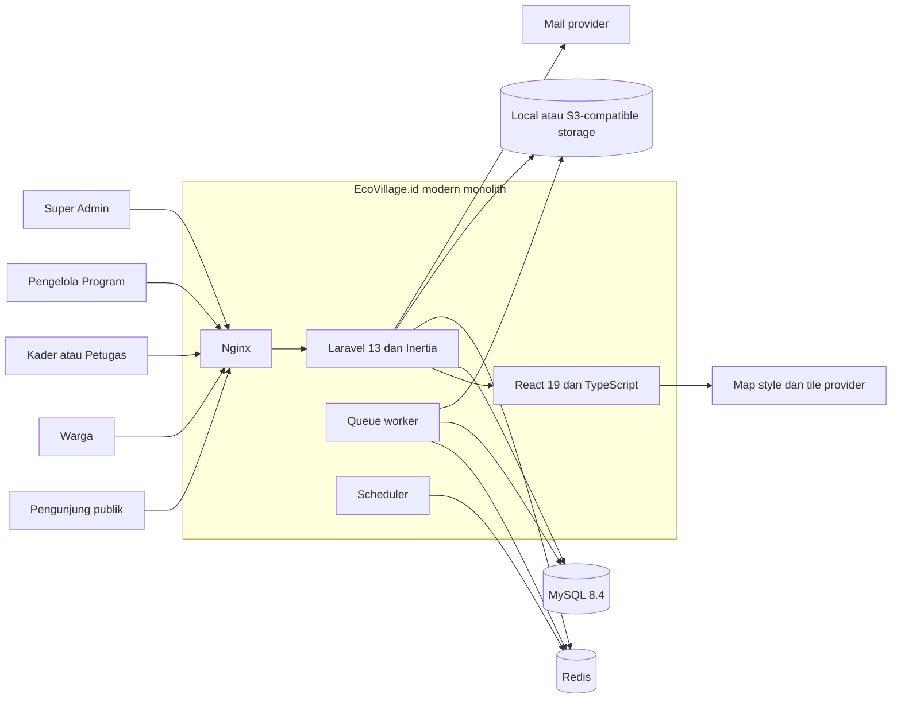
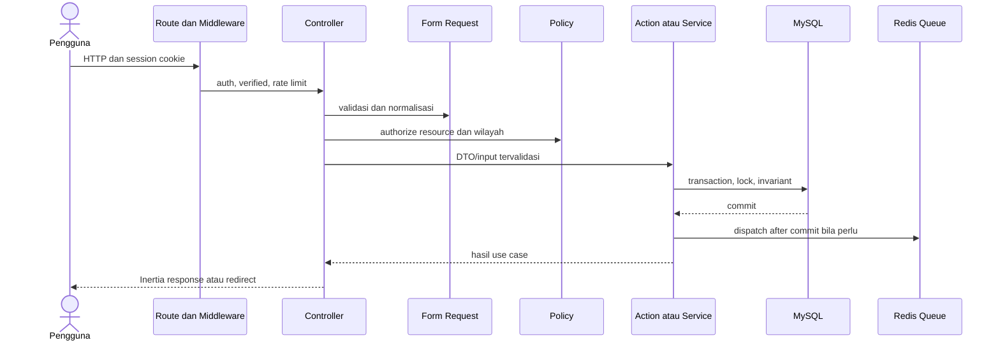

# Arsitektur EcoVillage.id

## Keputusan utama

EcoVillage.id menggunakan **modern monolith**: satu aplikasi Laravel menangani routing, session authentication, authorization, transaksi domain, queue, dan delivery halaman Inertia; React/TypeScript berada di `resources/js`. Pendekatan ini menjaga konsistensi transaksi pengumpulan, poin, stok, dan dampak tanpa kompleksitas distributed transaction.

Yang sengaja tidak digunakan: React Router, backend/frontend repository terpisah, microservices, GraphQL, Redux, dan event architecture lintas layanan. REST API versioned dapat ditambahkan kelak di `/api/v1` dengan memanggil application service/policy yang sama, bukan menduplikasi aturan domain.

## Konteks sistem



Browser menerima HTML awal dan page props dari Inertia, lalu melakukan navigasi SPA melalui endpoint Laravel. Session cookie bersifat HttpOnly; token autentikasi tidak disimpan di `localStorage`.

## Batas modul target

| Modul | Tanggung jawab | Invariant utama |
|---|---|---|
| Identity & Access | pengguna, profil, role/permission, penugasan wilayah | keputusan akses selalu ditegakkan backend melalui middleware/policy |
| Regions & Maps | hierarki wilayah, alamat, geometri, agregasi peta | koordinat rumah tidak pernah masuk response publik |
| Collection | permintaan, item, foto, assignment, status history | transisi mengikuti state machine dan petugas hanya menangani assignment aktif |
| Green Points | aturan poin, account, immutable ledger | poin berasal dari berat terverifikasi; saldo tidak boleh negatif; koreksi lewat reversal/adjustment |
| Impact | factor set berversi, faktor, calculation snapshot | hasil adalah estimasi, memakai versi faktor yang aktif saat verifikasi |
| Education | kategori dan materi publik | hanya konten published yang tampil publik |
| Programs | EcoPore/EcoCycle, sesi, pendaftaran, kehadiran | scope pengelola dibatasi program/wilayah |
| Marketplace | produk, inventory ledger, redemption | pengurangan poin dan stok atomik serta idempotent |
| Forum | ruang, thread, post, laporan/moderasi | visibility dan moderasi diperiksa di server |
| Platform | notification, audit log, site setting, queue | perubahan sensitif menghasilkan audit trail |

Tabel domain minimum sudah direpresentasikan pada migration bertanggal `2026_08_03`; itu membuktikan baseline schema, bukan kelengkapan use case, UI, policy, maupun pengujian. Status aktual ada di [IMPLEMENTATION_STATUS.md](IMPLEMENTATION_STATUS.md).

## Struktur aplikasi yang diharapkan

Gunakan lapisan paling kecil yang menjaga aturan tetap dapat diuji:

```text
app/
├── Actions/ atau Services/   # use case transaksional, bukan CRUD generik
├── Enums/                    # status dan tipe stabil
├── Http/
│   ├── Controllers/          # orkestrasi request/response tipis
│   └── Requests/             # normalisasi dan validasi input
├── Models/                   # relasi, cast, query scope
├── Policies/                 # otorisasi resource dan scope wilayah
├── Jobs/                     # efek samping asinkron yang aman diulang
└── Support/                  # value object/helper domain yang benar-benar bersama

resources/js/
├── components/               # primitive dan komponen lintas halaman
├── layouts/                  # public, authenticated, admin
├── pages/                    # halaman Inertia per domain
├── hooks/                    # perilaku UI bersama
└── types/                    # kontrak page props
```

Jangan membangun repository abstraction untuk Eloquent tanpa kebutuhan nyata. Query kompleks, agregasi spasial, atau locking boleh diletakkan pada query object/service yang bernama sesuai use case.

## Alur request dan authorization



`auth.user.permissions` atau capability yang dibagi ke React hanya untuk menyederhanakan UX. Ia tidak menggantikan policy di backend. Role bersifat global; yurisdiksi operasional ditentukan oleh `region_user_assignments` dan dicek bersama kepemilikan/assignment resource.

## Transaksi, konkurensi, dan idempotensi

- Verifikasi pengumpulan harus menjadi satu database transaction: lock permintaan dan account terkait, validasi status/assignment, simpan berat, status history, ledger Green Points, calculation snapshot, serta audit log. Job notifikasi dikirim setelah commit.
- Penukaran harus lock baris `point_accounts` dan produk terkait; validasi saldo/stok; buat redemption snapshot, point transaction, dan inventory movement dalam satu transaction.
- `idempotency_key` dan unique constraint adalah pagar terakhir terhadap retry/double submit. Response retry mengembalikan hasil transaksi yang sama dan tidak membuat side effect baru.
- Ledger poin dan inventory movement tidak diedit untuk mengoreksi sejarah. Gunakan reversal/adjustment yang mereferensikan transaksi asal.
- Efek samping queue harus idempotent dan menggunakan identifier domain stabil. Jangan mengantre mutasi verifikasi atau redemption secara diam-diam ketika browser offline.

## Data dan spasial

- Source of truth produksi/development adalah MySQL 8.4.
- Koordinat disimpan sebagai kolom `latitude`/`longitude` numerik (WGS84/EPSG:4326) dan menjadi satu-satunya representasi lokasi. Tidak ada tipe geometry maupun index spasial, sehingga tidak ada dua representasi yang perlu disinkronkan.
- Region ditentukan secara relasional melalui `region_id` pada alamat, bukan melalui containment spasial.
- Peta publik dibangun dari query agregasi terhadap data `verified/completed`, bukan mengekspor titik mentah. Peta internal memakai policy dan scope assignment.
- `address_snapshot`, factor snapshot, dan product snapshot menjaga fakta historis ketika master data berubah.

## File, PWA, dan integrasi eksternal

- Development menggunakan local disk; production menggunakan S3-compatible disk melalui environment. Bukti/foto privat tidak diletakkan pada public disk dan diakses melalui signed URL berumur pendek.
- PWA hanya boleh cache app shell, fallback offline, dan materi edukasi publik yang memang aman. Response autentikasi, profil, alamat, lokasi, dashboard internal, Inertia page sensitif, dan API mutasi harus `NetworkOnly`/tidak disimpan.
- Map style/tile URL berasal dari `VITE_MAP_STYLE_URL`. Secret tile provider, mail, atau storage tidak boleh dibundel ke client.
- Mail/notifikasi dan pemrosesan media dapat memakai queue; keputusan transaksi inti tetap sinkron di MySQL.

## Observability dan operasi

- `/up` adalah liveness endpoint dasar, bukan bukti readiness semua dependency.
- Log aplikasi dikirim ke stdout/stderr di container production. Audit log domain terpisah dari operational log dan tidak boleh memuat secret.
- Metrik minimum yang perlu ditambahkan sebelum production: error rate, latency, queue depth/failure, deadlock/retry, penggunaan storage, koneksi database, dan hasil backup.
- Deployment tidak menjalankan migration otomatis pada setiap startup. Migration adalah release task terkontrol dengan backup dan rencana rollback.

## Batas sumber

`projectan.pdf` yang ditemukan pada host telah diperiksa lengkap; hasil dan checksum-nya dicatat pada `SOURCE_AUDIT.md`. PDF dipakai sebagai referensi prototype lama untuk sitemap/alur, sedangkan brief terbaru menjadi sumber keputusan produk dan keamanan. Foto sketsa terpisah tidak ditemukan. Nama `Kita.hijau` tidak menjadi identitas aplikasi.
