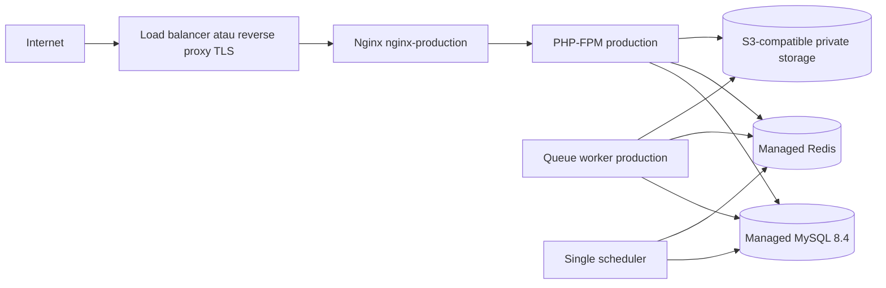

# Deployment EcoVillage.id

Dokumen ini memisahkan tiga status: **validated locally**, **image/package ready**, dan **live verified**. Build atau test lokal tidak membuktikan aplikasi sudah live. Pada snapshot awal ini belum ada verifikasi server production.

## Artefak container

`Dockerfile` menyediakan target:

| Target | Fungsi |
|---|---|
| `development` | PHP-FPM, Composer dependency, Node/npm, dan source untuk bind mount lokal |
| `build` | menghasilkan aset Vite dan vendor production |
| `production` | runtime PHP-FPM tanpa Node dan dependency dev |
| `nginx-production` | Nginx plus public assets dari build yang sama |

`compose.yaml` adalah environment development/reference, bukan manifest production siap pakai. Ia menjalankan `app`, `web`, `vite`, `queue`, `scheduler`, `mysql:8.4`, dan `redis:7.4-alpine`. Source bind mount, port database/Redis host, dan Vite tidak dipakai pada production.

## Topologi production



Service DNS PHP-FPM harus bernama `app` atau `fastcgi_pass` di Nginx diubah melalui template deployment. Web dan PHP image harus berasal dari commit/release yang sama agar manifest aset sinkron.

## Build dan registry

Contoh build lokal dengan immutable tag:

```bash
docker build --target production -t registry.example/ecovillage/app:<commit-sha> .
docker build --target nginx-production -t registry.example/ecovillage/web:<commit-sha> .
docker push registry.example/ecovillage/app:<commit-sha>
docker push registry.example/ecovillage/web:<commit-sha>
```

Jangan memakai `latest` sebagai satu-satunya referensi release. CI seharusnya menjalankan Composer validation, lint, static analysis, backend test pada MySQL, frontend lint/type check, production build, dan browser smoke test sebelum push/promote.

Build arg `VITE_MAP_STYLE_URL` adalah konfigurasi publik yang masuk bundle. Jangan memasukkan secret pada build arg `VITE_*`; semua variabel Vite dapat dibaca browser.

## Environment dan secret

Gunakan secret manager platform. Minimum production:

- `APP_ENV=production`, `APP_DEBUG=false`, `APP_KEY` unik dan persisten, `APP_URL=https://...`;
- `APP_LOCALE=id`, `APP_FALLBACK_LOCALE=id`, timezone aplikasi/PHP `Asia/Jakarta`;
- koneksi MySQL dengan TLS sesuai provider (`MYSQL_ATTR_SSL_CA`) dan user least privilege;
- Redis password/TLS sesuai provider, queue/cache/session database terpisah secara logis bila perlu;
- `SESSION_SECURE_COOKIE=true`, `SESSION_HTTP_ONLY=true`, `SESSION_SAME_SITE=lax`, domain cookie yang tepat;
- `TRUSTED_PROXIES` berisi CIDR reverse proxy/load balancer di depan aplikasi;
- `MAIL_MAILER` diarahkan ke provider SMTP/API sungguhan, sebaiknya lewat mailer `failover` agar kegagalan transport tidak menjatuhkan pendaftaran. Bila memang belum ada layanan email, setel `REQUIRE_EMAIL_VERIFICATION=false` secara sadar: akun baru langsung aktif, dan `ecovillage:check-production` akan menurunkan status MAIL_MAILER dari GAGAL menjadi PERIKSA;
- `MAP_TILE_ORIGINS` diisi bila tile/sprite peta berasal dari host selain `VITE_MAP_STYLE_URL`; nilainya masuk ke `img-src` dan `connect-src` pada CSP;
- `FILESYSTEM_DISK=s3`/`PRIVATE_UPLOAD_DISK=s3`, S3-compatible private bucket, dan mail provider;
- map style URL tanpa secret, atau token publik yang dibatasi origin/quota.

`APP_KEY`, DB/Redis password, AWS secret, SMTP credential, dan provider token tidak boleh dibundel ke image, ditulis ke repository, atau muncul dalam log. Rotasi `APP_KEY` dapat membatalkan session dan membuat data terenkripsi lama tidak terbaca; lakukan hanya dengan runbook khusus.

`APP_TIMEZONE` dibaca oleh `config/app.php`; image PHP juga menetapkan `Asia/Jakarta`. Tetap verifikasi timestamp database, queue, scheduler, ekspor, dan UI pada staging untuk mencegah konversi ganda atau asumsi timezone browser.

## Database

Production memerlukan MySQL 8.4. Buat database dengan charset yang benar saat provisioning:

```sql
CREATE DATABASE ecovillage CHARACTER SET utf8mb4 COLLATE utf8mb4_unicode_ci;
```

Migration application user harus memiliki hak schema yang cukup (DDL pada database aplikasi) tetapi tidak perlu privilege administratif global untuk operasi harian.

`compose.yaml` memakai `mysql:8.4` dengan named volume pada `/var/lib/mysql`. Jangan menunjuk volume dari versi mayor lain tanpa membaca prosedur upgrade dan melakukan backup/restore test.

Seluruh tingkat test memakai MySQL yang sama dengan production: PHPUnit pada database `*_test`, Playwright pada database `*_e2e`. Tidak ada engine berbeda antara test dan production, sehingga locking dan constraint concurrency teruji pada engine yang sebenarnya dipakai.

MySQL membatasi identifier pada 64 karakter. Index gabungan pada nama tabel/kolom yang panjang harus diberi nama eksplisit di migration.

## Urutan release

1. Pastikan backup berhasil dan restore drill terbaru masih valid.
2. Deploy image ke staging dengan secret staging.
3. Jalankan test/smoke test pada staging dan periksa migration plan.
4. Jalankan migration sebagai **one-off release task**, tepat satu kali, lalu verifikasi konfigurasi environment tujuan:

   ```bash
   php artisan migrate --force
   php artisan ecovillage:check-production
   php artisan ecovillage:check-deploy-config
   ```

   Keduanya keluar dengan kode selain nol bila ada baris GAGAL, sehingga pipeline berhenti sebelum traffic dialihkan.

5. Jalankan app/web revision yang sama, lalu queue worker dan tepat satu scheduler.
6. Untuk worker lama, lakukan graceful restart setelah revision baru sehat:

   ```bash
   php artisan queue:restart
   ```

7. Verifikasi health, login, CSRF/session cookie, read/write DB, queue, storage signed URL, map, dan alur kritis dengan data staging/sintetis.
8. Promosikan traffic bertahap dan pantau error/latency/queue/deadlock.

Migration tidak dijalankan otomatis pada container startup agar beberapa replica tidak berlomba. Perubahan schema harus backward-compatible untuk strategi rolling deployment: add nullable/default column dulu, deploy code transisi, backfill terukur, baru enforce/drop pada release berikutnya.

Jika memakai `config:cache`, jalankan setelah environment runtime tersedia pada setiap container/revision. Jangan membuat config cache saat image build dengan secret/build environment karena nilainya akan membeku di artefak.

## Proses runtime

| Proses | Command | Skala |
|---|---|---|
| PHP-FPM | `php-fpm -F` | horizontal sesuai beban |
| Nginx | `nginx -g 'daemon off;'` | horizontal bersama app |
| Queue | `php artisan queue:work redis --sleep=1 --tries=3 --timeout=90 --max-time=3600 --no-interaction` | ≥1, dapat horizontal |
| Scheduler | `php artisan schedule:work --no-interaction` atau cron `schedule:run` per menit | tepat satu logical scheduler |

Set termination grace queue lebih panjang dari timeout job dan gunakan `queue:restart` saat deploy. Job harus idempotent dan dispatch setelah database commit. Failed job harus memiliki alert dan runbook retry; jangan retry tanpa memeriksa side effect.

## File storage

Production multi-replica menggunakan S3-compatible storage; local disk container bersifat ephemeral dan tidak dibagi antarpod. Bukti/foto sensitif disimpan privat dan dilayani melalui signed URL/controller ber-policy. Hanya aset public yang boleh ada pada public prefix.

Nginx production image sudah membawa aset hasil Vite. Ia tidak membutuhkan write access ke source. Jika masih memakai local public uploads pada single-host deployment, sediakan volume terkontrol hanya untuk `storage/app/public` dan pastikan symlink/share tersedia pada web serta app; ini tidak direkomendasikan untuk horizontal scaling.

## TLS, headers, dan PWA

- Terminasi TLS dapat berada di load balancer/reverse proxy. Isi `TRUSTED_PROXIES` dengan CIDR proxy tersebut (atau `*` bila PHP-FPM tidak dapat dijangkau langsung dari internet); `AppServiceProvider::configureTrustedProxies()` membacanya melalui `config('ecovillage.trusted_proxies')` sehingga tetap berlaku saat `config:cache` aktif. Tanpa nilai ini Laravel menganggap seluruh request sebagai HTTP dari IP proxy: HSTS tidak pernah dikirim dan audit log kehilangan IP pengguna.
- Redirect HTTP ke HTTPS di edge. Aktifkan HSTS setelah domain/subdomain dan sertifikat stabil.
- CSP aktif dan ditegakkan oleh `App\Http\Middleware\SecurityHeaders` memakai nonce per request. `script-src` tidak memuat `'unsafe-inline'` maupun `'unsafe-eval'`; `worker-src` mengizinkan `blob:` untuk worker MapLibre; origin style/tile diambil dari `VITE_MAP_STYLE_URL` dan `MAP_TILE_ORIGINS`. Perubahan kebijakan sebaiknya diuji lebih dulu dengan `CSP_REPORT_ONLY=true`. Nginx tidak boleh ikut menetapkan header dinamis; `ecovillage:check-deploy-config` menolak duplikasi itu.
- Service worker dan manifest tidak boleh memakai immutable cache. Konfigurasi Nginx awal mengantisipasi `/build/sw.js` dan `/build/manifest.webmanifest`; path akhir harus disamakan dengan output `vite-plugin-pwa` dan diuji setelah PWA benar-benar dikonfigurasi.
- Response sensitif harus `Cache-Control: private, no-store`; CDN/edge tidak boleh cache cookie-authenticated Inertia pages.

## Health dan observability

`/up` adalah liveness dasar. Tambahkan readiness terotentikasi/internal yang memeriksa dependency secara bounded tanpa membocorkan detail. Healthcheck tidak menggantikan synthetic flow.

Alert minimum:

- HTTP 5xx, p95/p99 latency, saturation PHP-FPM;
- DB connection/deadlock/slow query dan storage capacity;
- Redis availability/memory/eviction;
- queue depth, oldest job, failed jobs, scheduler heartbeat;
- object storage/mail failure;
- login anomaly/rate limit, perubahan privilege, dan akses lokasi sensitif;
- backup gagal atau restore drill kedaluwarsa.

Log container dikirim ke centralized logging dengan redaction. Audit log domain disimpan terpisah dan dibatasi aksesnya.

## Backup, restore, dan recovery

- Gunakan backup terjadwal/PITR provider untuk MySQL, versioning/lifecycle yang sesuai untuk bucket, dan backup konfigurasi non-secret.
- Redis bukan source of truth untuk ledger; cache/session dapat hilang dengan konsekuensi yang dipahami. Queue durability disesuaikan risiko job.
- Enkripsi backup, batasi IAM, dan dokumentasikan RPO/RTO setelah disetujui bisnis.
- Lakukan restore drill ke environment terisolasi, jalankan migration/status check, validasi jumlah data/constraint, lalu smoke test aplikasi dan signed file.
- Jangan menyatakan backup siap hanya karena file dump berhasil dibuat; restore yang diuji adalah bukti operasional.

Contoh logical backup manual (credential diberikan melalui mekanisme aman, bukan command history):

```bash
mysqldump --single-transaction --routines --triggers --set-gtid-purged=OFF \
  --result-file=ecovillage.sql "$DB_DATABASE"
mysql --execute="SOURCE ecovillage.sql" "$DB_RESTORE_TARGET"
```

## Rollback

Rollback code memakai tag image sebelumnya setelah memastikan schema masih kompatibel. Jangan menjalankan `migrate:rollback` secara buta di production; migration `down()` dapat menghapus tabel/data. Untuk migration destruktif, gunakan forward fix/restore plan yang direview.

Jika release membuat transaksi salah, hentikan jalur mutasi, pertahankan ledger/audit, lalu koreksi melalui reversal/adjustment yang dapat ditelusuri. Jangan mengedit balance/stock/history langsung.

## Checklist go-live

- [ ] Seluruh quality gate lulus di commit yang sama dengan image.
- [ ] Test MySQL dan concurrency lulus.
- [ ] Policy lintas user/role/wilayah dan endpoint langsung lulus.
- [ ] Secret, HTTPS, cookie, proxy, rate limit, dan security header diverifikasi.
- [ ] Factor set production memiliki sumber/review; tidak memakai label demo.
- [ ] Peta publik tidak memuat titik mentah; suppression/filter diuji.
- [ ] PWA tidak cache data sensitif dan update/offline flow diuji.
- [ ] Queue/scheduler, signed storage, mail, dan upload validation lulus.
- [ ] Backup dan restore drill lulus; RPO/RTO disepakati.
- [ ] Monitoring/alert/on-call/runbook aktif.
- [ ] Smoke test desktop/mobile selesai dan logout diverifikasi.
- [ ] Domain, DNS, TLS, dan server production diverifikasi langsung sebelum status dinyatakan live.
