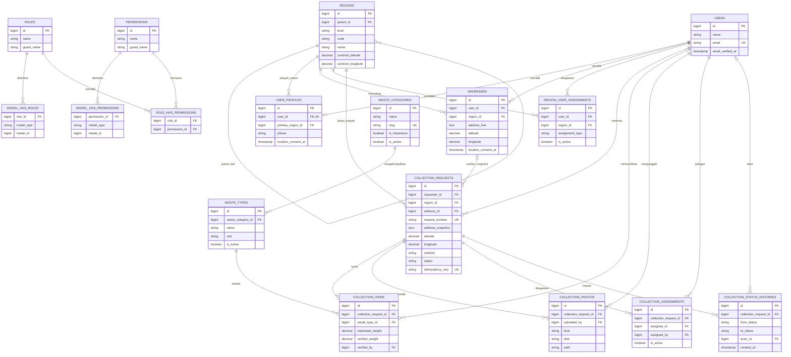
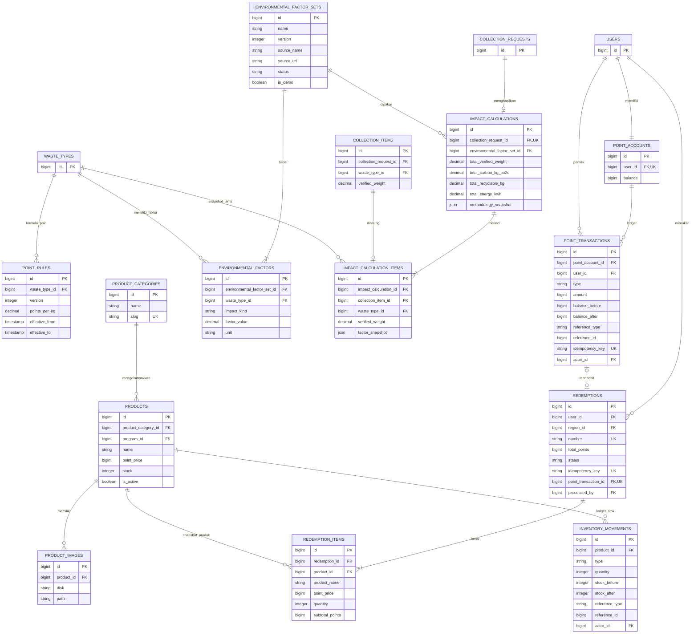
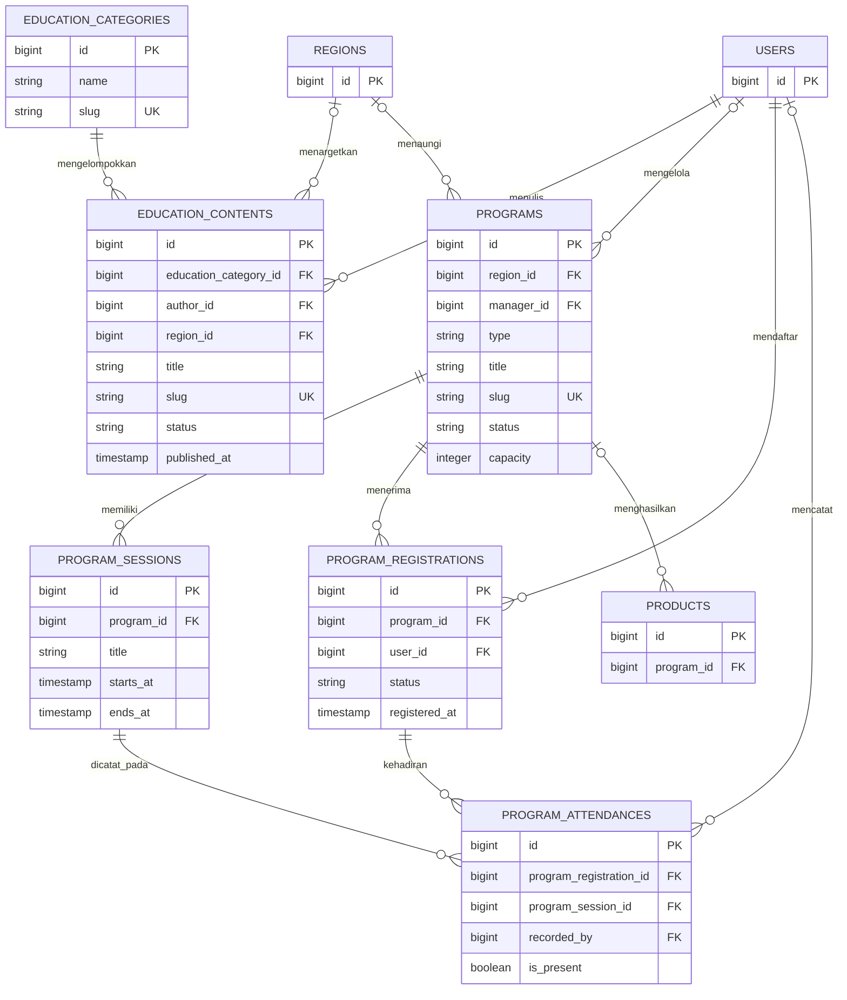
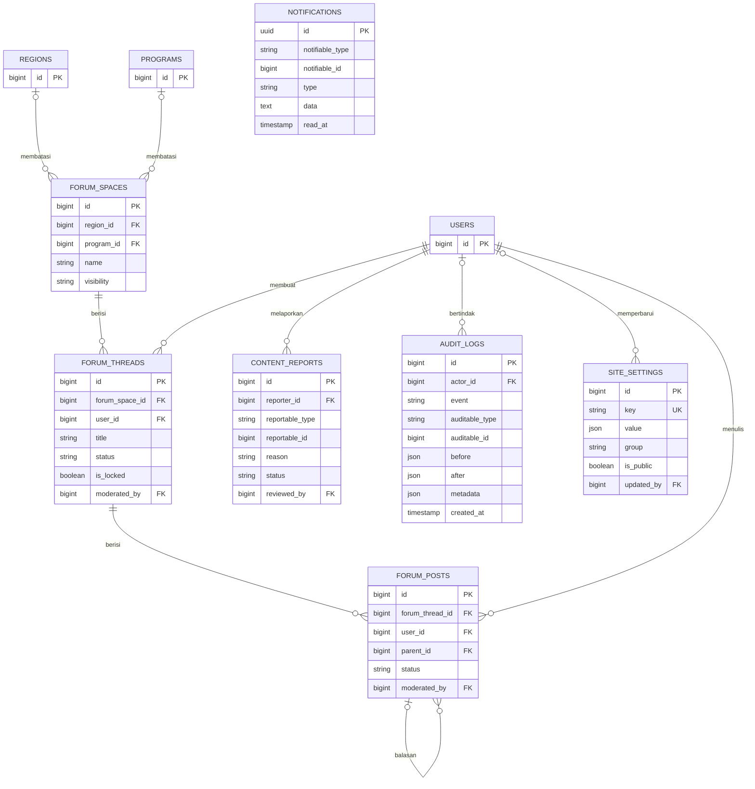

# ERD EcoVillage.id

Dokumen ini menggambarkan **baseline schema domain pada migration `2026_08_03_000100` sampai `000500`**. Relasi polymorphic ditulis sebagai pasangan `*_type`/`*_id`. Tabel framework seperti cache, jobs, sessions, passkeys, dan password reset sengaja tidak digambar agar ERD domain tetap terbaca.

Keberadaan tabel tidak membuktikan bahwa model, policy, use case, UI, seed, dan test telah lengkap. Lihat [status implementasi](IMPLEMENTATION_STATUS.md).

## Identitas, wilayah, dan pengumpulan

Lokasi disimpan sebagai pasangan kolom desimal (WGS84/EPSG:4326): `regions.centroid_latitude`/`centroid_longitude`, `addresses.latitude`/`longitude`, dan `collection_requests.latitude`/`longitude`. Hanya ada satu representasi koordinat, sehingga tidak ada risiko desinkronisasi antar-representasi.

## Green Points, Estimasi Dampak, dan marketplace

`point_accounts.balance` dan `products.stock` adalah proyeksi cepat yang hanya boleh berubah bersama ledger dalam transaction dan row lock. Point transaction serta inventory movement tidak dihapus/diedit untuk menulis ulang sejarah.

## Edukasi dan program

## Forum dan platform

`CONTENT_REPORTS`, `NOTIFICATIONS`, dan `AUDIT_LOGS` memakai relasi polymorphic sehingga garis ke setiap target potensial tidak digambar. Application policy wajib memvalidasi tipe target yang diizinkan; `*_type` dari input pengguna tidak boleh dipercaya langsung.

## Constraint penting dan gap schema

- Request, point transaction, dan redemption memiliki unique idempotency key; satu request hanya boleh memiliki satu `impact_calculation`.
- Historical snapshot tersedia pada alamat pengumpulan, faktor/metodologi, dan item redemption.
- Factor set menyimpan sumber, versi, tanggal berlaku, status, dan flag demo. Brief juga meminta cakupan/wilayah eksplisit; field itu belum tampak pada migration baseline dan harus diselesaikan sebelum klaim metodologi production.
- Status saat ini berupa string dan dipetakan ke PHP enum. Validitas transisi tetap harus ditegakkan di service/state machine; schema string saja tidak cukup.
- Tidak ada tipe atau index spasial pada schema; seluruh query lokasi memakai kolom desimal dan divalidasi pada MySQL yang sama dengan production.
