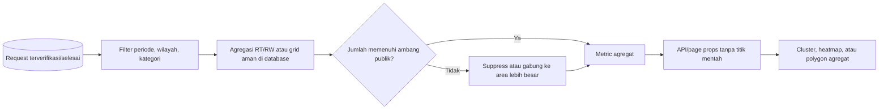

# Kebijakan Privasi dan Peta

Dokumen ini adalah baseline teknis privacy-by-design, bukan pengganti pemberitahuan privasi atau nasihat hukum. Retensi, dasar pemrosesan, hak subjek data, dan mekanisme penghapusan wajib disahkan pemilik program sesuai yurisdiksi sebelum production.

## Klasifikasi data

| Kelas | Contoh | Akses | Aturan utama |
|---|---|---|---|
| Publik | materi edukasi published, program publik, statistik agregat | semua pengunjung | boleh di-cache bila tidak mengandung data personal |
| Internal terbatas | dashboard wilayah, status operasional, jadwal, assignment | kader/pengelola sesuai scope | session auth, policy wilayah, no public cache |
| Personal | nama, email, telepon, profil, riwayat kontribusi/poin | pemilik dan petugas berkepentingan | minimisasi, purpose limitation, audit akses sensitif |
| Sangat sensitif operasional | alamat rumah, koordinat tepat, foto lokasi, bukti pengambilan | pemilik dan aktor berwenang untuk tugas aktif | private storage, signed URL, presisi/masa akses minimum |
| Ledger/audit | point transaction, inventory movement, audit log | role sangat terbatas | immutable secara aplikasi; koreksi melalui record baru |
| Secret | APP_KEY, password DB/Redis, storage key, provider token | platform/secret manager | tidak masuk repository, log, browser bundle, atau screenshot |

Data seed/demo harus sintetis. Nama, alamat, nomor telepon, dan titik pada dokumen sumber tidak boleh disalin sebagai data warga nyata.

## Persetujuan lokasi

- Geolocation tidak berjalan otomatis atau di background. Browser hanya meminta lokasi setelah tindakan dan penjelasan pengguna yang jelas.
- Form menyediakan pilihan menentukan titik secara manual pada peta. Pengguna dapat membuat alamat tanpa koordinat bila alur layanan mengizinkan.
- Consent mencatat waktu dan tujuan; consent bukan checkbox permanen untuk semua tujuan di masa depan.
- Menolak/revoke consent tidak boleh menghalangi fitur yang tidak memerlukan lokasi. Dampak pada request aktif dijelaskan sebelum perubahan.
- Alamat snapshot dan titik request hanya disalin ketika diperlukan untuk pemenuhan layanan.

## Kebijakan peta publik

Response publik **tidak pernah berisi** alamat, nama warga, request number personal, foto, atau koordinat titik rumah. Data yang eligible hanya request yang telah terverifikasi/selesai sesuai rule publik.

Pipeline publik:

Ambang minimum (`k`), resolusi grid, rentang waktu, dan suppression rule harus menjadi setting yang direview berdasarkan kepadatan wilayah; dokumen ini tidak mengarang nilai universal. Area kecil/kejadian langka harus digabung atau disembunyikan. Random jitter titik rumah **bukan** anonimisasi yang memadai dan tidak digunakan sebagai pengganti agregasi.

Filter tidak boleh memungkinkan differencing attack, misalnya membandingkan dua rentang sempit untuk menyimpulkan satu rumah. Terapkan pembatasan rentang minimum, kombinasi filter aman, rate limit, dan suppression konsisten. Ekspor publik mengikuti rule yang sama dengan UI.

## Kebijakan peta internal

- Warga dapat melihat titik milik sendiri.
- Kader melihat titik tepat hanya untuk request aktif yang ditugaskan kepadanya.
- Pengelola melihat titik operasional hanya pada yurisdiksi aktif dan sesuai kebutuhan penjadwalan/review.
- Super admin memiliki akses lintas wilayah untuk fungsi yang sah, bukan akses tanpa audit atau invariant.
- Setelah tugas selesai, view operasional umum menurunkan presisi ke agregat/centroid area. Akses histori detail, jika diwajibkan, memakai permission khusus, tujuan eksplisit, dan audit.
- Endpoint spasial menerapkan policy sebelum query/serialization; filtering hanya di React tidak diterima.

Map style/tile URL dikonfigurasi melalui `VITE_MAP_STYLE_URL`. Data yang dikirim ke penyedia tile harus dibatasi pada viewport/request teknis; jangan memasukkan alamat, user ID, atau secret ke query string. Tinjau privacy policy dan data residency penyedia sebelum production.

## File dan foto

- Foto request/bukti default ke disk privat. Nama file acak; metadata database menyimpan disk/path, MIME, ukuran, dan uploader.
- Server memvalidasi MIME aktual, extension yang diizinkan, ukuran, dimensi, serta melakukan decode/re-encode/scan bila pipeline tersedia. Nama file dan MIME dari browser tidak dipercaya.
- Hapus EXIF/GPS sebelum varian foto ditampilkan lebih luas dari aktor operasional yang membutuhkan.
- Akses objek privat melalui controller ber-policy atau signed URL berumur pendek. Bucket/listing tidak publik.
- Public disk hanya untuk aset yang memang disetujui publik, seperti cover materi published; jangan menjalankan `storage:link` lalu menyimpan bukti sensitif pada disk `public`.

## Session, PWA, dan browser storage

- Autentikasi memakai Laravel session cookie HttpOnly, SameSite, dan Secure pada HTTPS production; CSRF tetap aktif.
- Service worker tidak cache HTML/Inertia response autentikasi, profil, alamat, lokasi, dashboard, forum privat, endpoint mutasi, signed URL, atau response dengan `Cache-Control: private/no-store`.
- Cache PWA dibatasi pada hashed static assets, offline shell, dan materi edukasi publik yang aman. Logout menghapus cache user-specific bila pernah dibuat.
- Token, password, alamat, foto, point transaction, dan payload verifikasi tidak disimpan di `localStorage`.
- Draft offline hanya diizinkan untuk data nonsensitif yang jelas, dienkripsi bila threat model menuntut, memiliki expiry, dan memerlukan konfirmasi sebelum submit ulang. Verifikasi, pemberian poin, dan redemption tidak diantrekan diam-diam ketika offline.

## Logging, audit, dan analytics

- Operational log tidak memuat password, token, cookie, APP_KEY, full request body, signed URL, alamat lengkap, atau koordinat tepat.
- Audit log mencatat aktor, event, target, waktu, dan perubahan relevan; field sensitif dimasking/minimalkan. Audit log tidak dapat dihapus dari UI/admin biasa.
- Akses/ekspor lokasi tepat, role/permission, factor set, point adjustment, dan moderasi sensitif wajib diaudit.
- Analytics client tidak menerima data personal/koordinat tanpa kebutuhan dan persetujuan terpisah. Session replay harus memask input dan dilarang pada halaman alamat/lokasi sampai ditinjau.

## Retensi dan penghapusan akun

Durasi retensi belum ditetapkan oleh artefak yang tersedia. Sebelum production, pemilik program dan reviewer hukum harus menyetujui jadwal per kelas data untuk:

- akun/profil dan alamat;
- foto request/bukti;
- koordinat tepat dan assignment history;
- pengumpulan, impact snapshot, point/inventory ledger;
- forum dan laporan moderasi;
- audit/operational log, backup, dan cache.

Penghapusan akun memutus akses dan menghapus/menganonimkan profil, alamat, consent, token/passkey, dan media sejauh diperbolehkan. Transaksi/ledger/audit yang wajib dipertahankan menggunakan pseudonymous actor/tombstone dan tidak mempertahankan PII yang tidak perlu. Cascade delete tidak dijalankan tanpa menguji kewajiban histori.

## Security controls minimum

- email verification, password hashing, reset flow, session regeneration, CSRF, dan rate limiting login/endpoint sensitif;
- Form Request validation dan policy pada setiap operasi;
- output escaping/sanitasi konten rich text, Eloquent/query bindings, mass-assignment allowlist;
- TLS end-to-end, secure cookie, dependency/secret scan, dan security headers;
- least-privilege DB/storage credentials dan rotasi secret;
- encrypted backup, restore test, dan incident response untuk kebocoran lokasi.

## Verification checklist

- Inspect response/network peta publik untuk memastikan tidak ada lat/lng titik mentah atau identifier personal.
- Uji user/role/wilayah silang terhadap endpoint langsung, export, signed URL, dan websocket/notifikasi bila ada.
- Audit service worker cache melalui DevTools setelah login, navigasi sensitif, logout, dan offline.
- Pastikan object privat tidak dapat diakses tanpa session/policy atau setelah signed URL kedaluwarsa.
- Uji foto ber-MIME palsu, file terlalu besar, metadata EXIF, path traversal, dan SVG/script payload.
- Verifikasi production cookie (`Secure`, `HttpOnly`, `SameSite`) dan response `Cache-Control`.
- Jalankan tabletop incident untuk ekspos koordinat dan restore/deletion backup.

## Batas sumber

`projectan.pdf` telah diperiksa, tetapi tidak ada titik, alamat, nama warga, nomor kontak, atau foto dari dokumen tersebut yang digunakan. Foto sketsa terpisah tidak ditemukan. Keputusan legal dan angka suppression/retention masih membutuhkan persetujuan eksplisit sebelum go-live.
