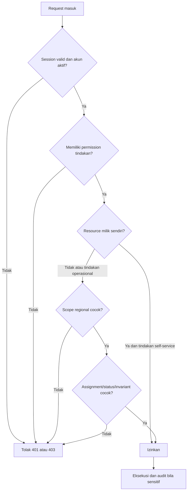

# Matriks Role dan Permission

Dokumen ini adalah **kontrak authorization target**. Role enum memakai slug `warga`, `kader`, `pengelola`, dan `super-admin`; baseline schema Spatie dan `RolePermissionSeeder` tersedia. Matriks belum boleh dianggap sepenuhnya aktif sampai seluruh middleware/policy dan test lintas wilayah lulus.

## Prinsip akses

1. **Deny by default.** Route sensitif memakai session auth, email verification bila relevan, permission middleware, dan resource policy.
2. **Role bukan scope data.** Role diberikan global; `region_user_assignments` menentukan yurisdiksi kader/pengelola. Policy wajib memeriksa keduanya.
3. **Kepemilikan dan assignment tetap berlaku.** Warga hanya melihat resource sendiri; kader hanya melihat request aktif yang ditugaskan; pengelola hanya wilayah yang dikelola.
4. **Capability frontend hanya UX.** Menyembunyikan tombol atau page prop permission tidak pernah menggantikan pemeriksaan backend.
5. **Tidak ada privilege implisit dari ID.** Semua route model binding tetap melewati policy untuk mencegah IDOR/kebocoran antarwilayah.
6. **Perubahan sensitif diaudit.** Role/permission, wilayah, factor set, verifikasi, adjustment/reversal, stok, moderasi, dan site setting menghasilkan audit log.

## Matriks kemampuan

Legenda: **Milik** = resource milik pengguna; **Tugas** = assignment aktif; **Wilayah** = yurisdiksi aktif; **Global** = seluruh wilayah; **Tidak** = ditolak.

| Kemampuan | Warga | Kader/Petugas | Pengelola Program | Super Admin |
|---|---|---|---|---|
| Registrasi, login, reset password, verifikasi email | Milik | Milik | Milik | Milik |
| Lihat/ubah profil dan alamat | Milik | Milik | Milik | Global, dengan alasan operasional |
| Kelola persetujuan lokasi | Milik | Milik | Milik | Tidak boleh memalsukan consent pengguna |
| Buat permintaan dan unggah foto awal | Milik | Tidak | Dapat membantu hanya bila use case/audit disediakan | Global, bukan jalur normal |
| Lihat permintaan | Milik | Tugas | Wilayah | Global |
| Lihat titik lokasi tepat | Milik | Tugas aktif | Wilayah aktif sesuai kebutuhan operasional | Global dengan least privilege dan audit |
| Assign/reassign petugas | Tidak | Tidak | Wilayah | Global |
| Transisi status operasional | Batalkan milik sebelum `picked_up` | Tugas, sesuai state machine | Setujui/tolak dalam wilayah | Global, sesuai state machine |
| Input penimbangan/jenis terverifikasi | Tidak | Tugas setelah `picked_up` | Review wilayah | Global, dengan audit |
| Verifikasi B3 | Tidak | Hanya jika flag otorisasi/mitra aktif | Hanya petugas berwenang di wilayah | Hanya konfigurasi petugas berwenang; bukan bypass otomatis |
| Lihat Green Points dan dampak | Milik | Milik; ringkasan tugas bila perlu | Agregat wilayah | Global/agregat |
| Edit saldo poin langsung | Tidak | Tidak | Tidak | Tidak |
| Buat adjustment/reversal poin | Tidak | Tidak | Wilayah, alasan wajib | Global, alasan wajib |
| Kelola formula poin | Tidak | Tidak | Tidak kecuali permission khusus | Global |
| Kelola factor set dampak | Tidak | Tidak | Lihat versi aktif | Global; publish/archive diaudit |
| Baca materi edukasi published | Publik/milik | Publik | Publik | Publik |
| Buat/edit/publish materi edukasi | Tidak | Tidak | Wilayah | Global |
| Daftar EcoPore/EcoCycle | Milik | Milik | Dapat mengelola, bukan mendaftar atas nama tanpa audit | Global |
| Kelola program/sesi/kehadiran | Tidak | Catat kehadiran bila ditugaskan | Wilayah/program | Global |
| Lihat katalog dan membuat redemption | Milik | Milik | Milik | Milik |
| Proses redemption dan stok | Tidak | Tidak kecuali permission khusus | Wilayah/program | Global |
| Forum: baca/tulis/lapor | Sesuai visibility wilayah/program | Sesuai visibility | Sesuai visibility | Global |
| Moderasi forum/laporan konten | Tidak | Tidak kecuali moderator eksplisit | Wilayah/program | Global |
| Kelola user, role, permission, wilayah | Tidak | Tidak | Tidak | Global |
| Menjadi/menghapus super admin | Tidak | Tidak | Tidak | Kursi tunggal: tidak dapat ditambah, diturunkan, atau dihapus sendiri |
| Kelola site setting/landing | Tidak | Tidak | Tidak kecuali konten terdelegasi | Global |
| Lihat audit log | Tidak | Tidak | Tidak sampai daftar audit berscope wilayah | Global |
| Hapus audit log/point ledger | Tidak | Tidak | Tidak | Tidak |

## Katalog permission saat ini

`RolePermissionSeeder` menjadi source of truth awal. Nama yang telah didefinisikan:

| Domain | Permission |
|---|---|
| Pengumpulan | `collections.view-own`, `collections.view-assigned`, `collections.view-region`, `collections.create`, `collections.update-own`, `collections.assign`, `collections.process`, `collections.verify`, `collections.verify-hazardous`, `collections.export` |
| Lokasi | `map.view-exact-assigned`, `map.view-exact-region` |
| Poin/redemption | `points.view-own`, `points.view-region`, `points.adjust`, `redemptions.create`, `redemptions.process` |
| Edukasi/program/produk | `education.view`, `education.manage`, `programs.view`, `programs.manage`, `products.view`, `products.manage` |
| Forum | `forum.access`, `forum.moderate` |
| Administrasi | `users.manage`, `roles.manage`, `regions.manage`, `waste.manage`, `factors.manage`, `audit.view`, `settings.manage`, `reports.view`, `reports.export` |

Permission yang bersifat `*.view-region`/`*.manage` tetap memerlukan policy scope regional untuk pengelola; permission saja bukan akses global. `super-admin` menerima seluruh permission di seeder, tetapi tetap melewati invariant domain: tidak boleh mengedit ledger, membuat saldo negatif, melompati state machine tanpa use case khusus, atau menghapus audit log.

## Rule policy per resource

Untuk region hierarkis, scope pengelola pada RW dapat mencakup RT anak hanya bila query policy secara eksplisit menghitung descendant aktif. Jangan memakai prefix string/slug sebagai bukti hubungan; gunakan relasi `parent_id` atau query hierarki yang diuji.

## Skenario test minimum

- Warga A tidak dapat membuka request, alamat, dampak, poin, atau redemption Warga B.
- Kader RT A tidak dapat melihat request/titik RT B; kader yang tidak di-assign tidak dapat mengubah status meskipun satu wilayah.
- Titik tepat menghilang dari view operasional umum setelah tugas selesai.
- Pengelola RW 08 dapat mengelola descendant yang ditetapkan tetapi tidak RW lain.
- Role tanpa permission menerima 403 dari endpoint langsung walau tombol frontend dimanipulasi.
- Kader/pengelola/super admin tidak dapat mengedit balance atau menghapus ledger/audit log.
- Permission cache dibersihkan setelah role/permission berubah dan perubahan menghasilkan audit log.
- B3 hanya dapat diverifikasi aktor dengan otorisasi B3 eksplisit dan konfigurasi rujukan/mitra aktif.

## Gap implementasi yang harus ditutup

Enum role, tabel Spatie, permission seeder, policy domain utama, serta test manager lintas wilayah dan cakupan descendant tersedia; test tersebut lulus sebagai bagian dari suite MySQL. Namun sejumlah permission masih bergranularitas luas (`education.manage`, `products.manage`, dan sejenisnya), sehingga policy tetap wajib menjadi pembatas wilayah. Coverage belum mencakup seluruh endpoint, kombinasi role, dan perilaku di bawah beban konkuren. Karena itu matriks ini adalah **kontrak source-backed dengan coverage parsial**, bukan bukti bahwa seluruh kontrol akses telah lulus QA menyeluruh.
