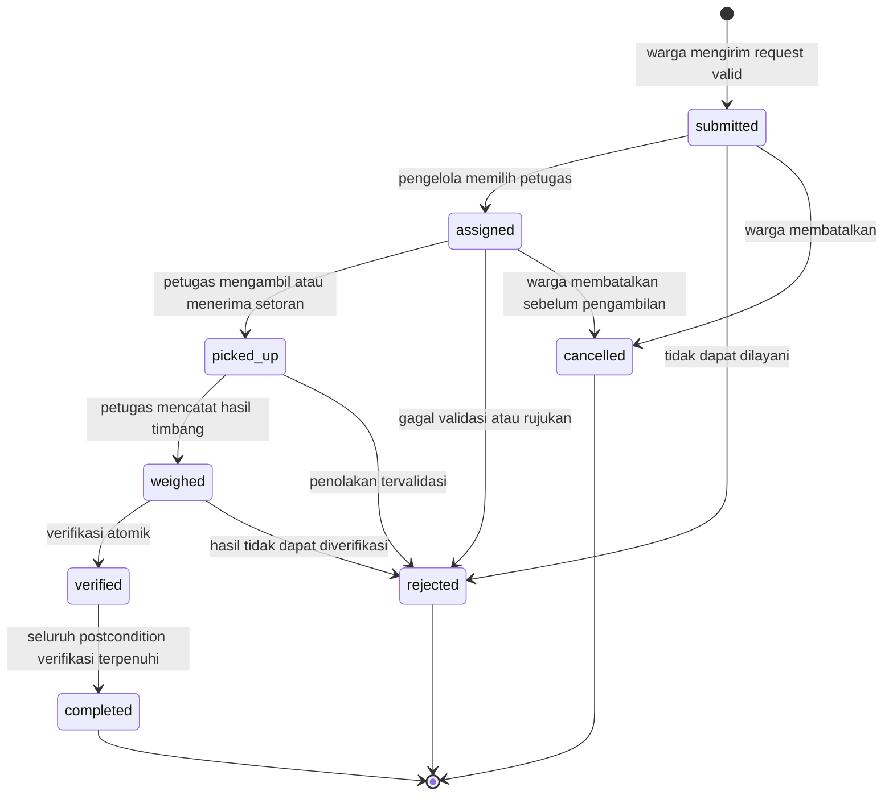
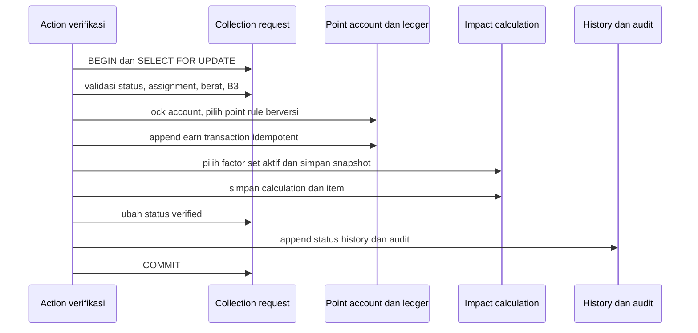
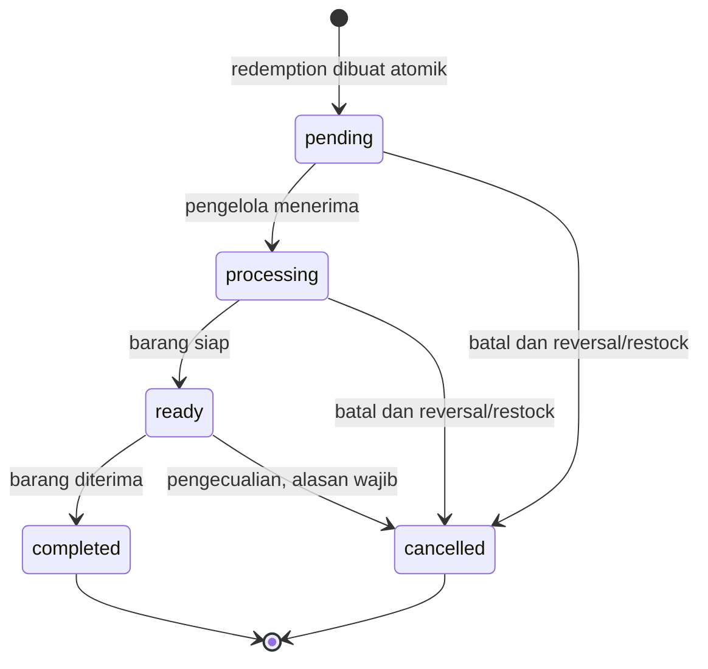
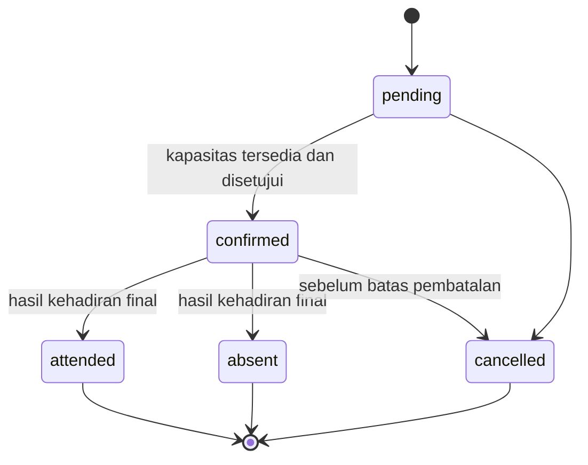
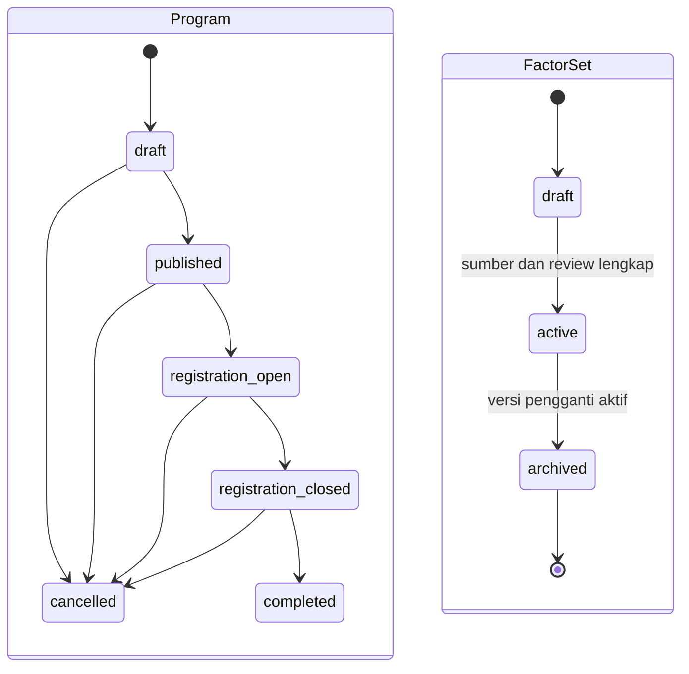

# State Machine EcoVillage.id

State machine utama adalah siklus permintaan pengumpulan. `App\Enums\CollectionStatus` telah mendefinisikan status dan transition map di bawah; enforcement tetap harus berada pada service/action transaksional dan diuji melalui endpoint, bukan hanya enum atau UI.

## Pengumpulan sampah

### Transition matrix

| Dari | Ke | Aktor utama | Guard wajib | Efek wajib |
|---|---|---|---|---|
| — | `submitted` | Warga | email/account valid; ≥1 item; alamat snapshot; metode; consent bila titik digunakan; idempotency key unik | nomor request; request/item/foto; history awal |
| `submitted` | `assigned` | Pengelola/Admin | scope wilayah; petugas aktif dan berwenang; untuk B3 harus ada jalur/petugas khusus | assignment aktif; history; audit; notifikasi |
| `submitted` | `rejected` | Pengelola/Admin | scope wilayah; alasan wajib | timestamp/reason; history; audit; notifikasi |
| `submitted` | `cancelled` | Pemilik | belum diambil | timestamp; history; notifikasi |
| `assigned` | `picked_up` | Petugas yang ditugaskan | assignment aktif; request belum terminal | bukti pengambilan bila diwajibkan; history; audit |
| `assigned` | `rejected` | Petugas/Pengelola | assignment/scope valid; alasan wajib | assignment ditutup; history; audit; notifikasi |
| `assigned` | `cancelled` | Pemilik atau Pengelola | pengambilan belum terjadi; alasan untuk aktor operasional | assignment ditutup; history; audit; notifikasi |
| `picked_up` | `weighed` | Petugas yang ditugaskan | setiap item memiliki berat aktual nonnegatif; jenis diverifikasi | simpan `verified_weight`, verifier, timestamp; history; audit |
| `picked_up` | `rejected` | Petugas/Pengelola | alasan wajib; tidak ada ledger poin/dampak | history; audit; notifikasi |
| `weighed` | `verified` | Pengelola atau petugas sesuai permission | berat/jenis final; factor set/point rule valid; belum pernah diproses | transaction verifikasi, point ledger, impact snapshot, history, audit |
| `weighed` | `rejected` | Pengelola | alasan wajib; belum ada award final | history; audit; notifikasi |
| `verified` | `completed` | Sistem/Pengelola | point/impact postcondition sukses atau explicit zero-result tercatat; tidak ada efek ganda | `completed_at`; history; notifikasi |

`completed`, `rejected`, dan `cancelled` adalah terminal. Koreksi setelah verifikasi tidak dilakukan dengan membuka ulang request atau mengedit ledger lama; gunakan reversal/adjustment yang diaudit dan, bila perlu, proses koreksi dampak yang mempertahankan snapshot lama.

### Transaction verifikasi

Transisi `weighed → verified` harus menjadi satu unit atomik:

Jika rule/factor tidak tersedia, implementasi tidak boleh mengarang angka. Pilihan aman adalah menolak verifikasi dengan error operasional yang jelas atau mencatat hasil zero/not-applicable yang telah disetujui metodologinya; status tidak boleh setengah berubah. Unique constraint request-impact dan idempotency key ledger mencegah retry menghasilkan duplikasi.

### B3/berbahaya

`is_hazardous=true` menambah guard, bukan menghapus state machine:

- Tanpa mitra/petugas B3 yang dikonfigurasi, request tidak masuk alur pengambilan umum. Ia berakhir `rejected` dengan reason code rujukan dan menampilkan kontak resmi yang dikonfigurasi admin.
- Jika jalur resmi tersedia, assignment hanya kepada aktor yang memiliki otorisasi B3 eksplisit untuk wilayah tersebut.
- Warga hanya menerima peringatan dan arahan menghubungi pengelola/mitra resmi; aplikasi tidak memberikan petunjuk teknis penanganan bahan berbahaya.
- Verifikasi B3 selalu menghasilkan audit log. Super admin tidak otomatis dianggap petugas lapangan berwenang.

## Penukaran Green Points

Enum `RedemptionStatus` menyediakan status berikut. Diagram adalah kontrak transition target; transition service/test belum boleh diasumsikan selesai hanya karena enum/table tersedia.

Pembuatan `pending` melakukan lock saldo dan stok, membuat snapshot item, debit ledger, dan inventory movement dalam satu transaction dengan idempotency key. Pembatalan setelah debit harus membuat point reversal dan stock-in movement; dilarang mengedit/hapus transaksi asal. `completed` dan `cancelled` terminal.

## Pendaftaran program

Kehadiran per sesi tetap dicatat di `program_attendances`; status registration adalah ringkasan peserta dan tidak boleh menggantikan detail sesi.

## Siklus program dan factor set

Diagram program mengikuti enum yang tersedia, tetapi transition validator belum terbukti ada. Aktivasi factor set harus transaksional, mencegah periode aktif tumpang tindih pada cakupan yang sama, dan tidak mengubah calculation lama. Factor set `archived` tidak diaktifkan ulang; buat versi baru.

## Persyaratan audit dan test

Setiap transition menyimpan `from_status`, `to_status`, aktor, waktu, reason/notes, serta metadata yang tidak memuat secret. Status update dan history berada dalam transaction yang sama.

Test minimum:

- seluruh edge yang diizinkan berhasil dan setiap edge lain ditolak;
- terminal state tidak dapat berubah;
- warga hanya membatalkan request sendiri sebelum `picked_up`;
- kader non-assignee dan aktor beda wilayah menerima 403;
- berat hanya dapat dimasukkan setelah `picked_up`;
- verifikasi retry dengan idempotency key yang sama tidak menggandakan poin/dampak;
- kegagalan di tengah verifikasi melakukan rollback seluruh perubahan;
- race verifikasi dan race redemption menghasilkan tepat satu transaksi final;
- B3 tanpa konfigurasi resmi tidak dapat di-assign ke alur umum;
- status history/audit selalu konsisten dengan status terakhir.
